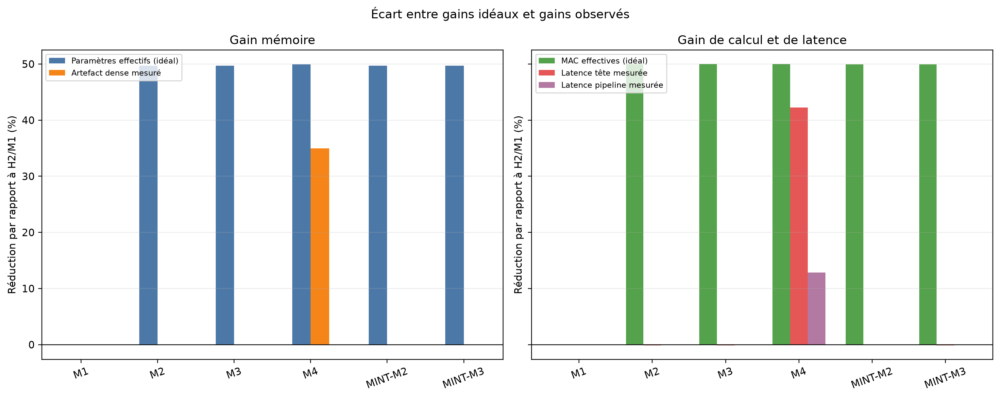

# Compression de modèles NLP pour l’analyse de sentiments

**Stage de recherche · ENSIIE · Juillet–août 2026**  
Mohamed Kassoul — Encadrement : Mounir Atiq · Tutrice académique : Mathilde Mougeot

Comment réduire le coût d’un classifieur de sentiments tout en préservant sa qualité de prédiction ? Ce projet compare le pruning **Optimal Brain Damage (OBD)**, le pruning **MINT** fondé sur l’information mutuelle, un **témoin aléatoire** et une **architecture dense plus petite**. Les expériences utilisent un même modèle Word2Vec figé pour isoler l’effet de la compression sur les têtes de classification.

[Rapport de stage](rapport/main.pdf) · [Guide expérimental](docs/GUIDE_EXPERIMENTAL.md) · [Résultats sur cinq graines](artifacts/repeated_runs/metrics_summary_long.csv) · [Code source](src/)

## Le projet en bref

- **Pipeline NLP** : tokenisation BPE, embeddings Word2Vec/CBOW de dimension 100, puis classification binaire des sentiments.
- **Comparaison contrôlée** : deux architectures de tête, un backbone partagé et des partitions de données fixes ; répétitions sur cinq graines, avec témoins dense et aléatoire.
- **Évaluation** : F1, ROC-AUC, loss, nombre de paramètres, coût du scoring, taille des artefacts et latence mesurée.
- **Question centrale** : distinguer la sparsité des poids des gains réellement obtenus à l’inférence.

**Technologies :** Python, PyTorch, Hugging Face Datasets et Tokenizers, scikit-learn, pandas, NumPy, Matplotlib et Seaborn.

## Principaux résultats

### Qualité de classification

F1 sur le jeu de test, présenté en **moyenne ± écart-type sur cinq graines** (`42` à `46`). Le Word2Vec et les partitions de données sont fixes entre les répétitions.

| Variante | H1 — une couche cachée | H2 — deux couches cachées |
| :--- | ---: | ---: |
| M1 — référence dense | 0,7456 ± 0,0048 | 0,7321 ± 0,0082 |
| OBD-M3 — pruning et réentraînement | 0,7512 ± 0,0048 | 0,7371 ± 0,0068 |
| MINT-M3 — pruning et réentraînement | Non évalué | 0,7430 ± 0,0101 |
| RAND-M3 — pruning aléatoire et réentraînement | 0,7335 ± 0,0057 | 0,7323 ± 0,0139 |
| M4 — architecture dense réduite | 0,7463 ± 0,0050 | 0,7345 ± 0,0100 |

Les variantes OBD-M3 et MINT-M3 conservent environ la moitié des poids de la tête et présentent un F1 moyen supérieur à celui de M1 dans ces expériences. Sur H2, les cinq graines ne suffisent toutefois pas à établir une supériorité claire sur le témoin aléatoire après réentraînement. MINT dépend fortement de ce réentraînement : sur H2, son F1 passe de **0,2028 ± 0,0938** juste après le masque à **0,7430 ± 0,0101** après réentraînement.

Sources : [résultats OBD, MINT et modèles denses](artifacts/repeated_runs/metrics_summary_long.csv), [résultats du témoin aléatoire](artifacts/random_pruning/metrics_summary.csv) et [comparaisons appariées](artifacts/random_pruning/paired_differences_summary.csv).

### Gains mesurés à l’inférence

Dans les mesures enregistrées pour H2, **M4 réduit la taille de l’artefact de 34,95 %, la latence de la tête de 42,27 % et celle du pipeline complet de 12,83 %**, relativement à M1. Ces chiffres correspondent au protocole et à l’environnement décrits dans le rapport.

Les modèles élagués OBD et MINT conservent des tenseurs PyTorch denses : leurs poids nuls ne se traduisent donc pas par une réduction comparable du stockage ou de la latence. L’architecture M4, dont les dimensions sont effectivement plus petites, apporte les gains matériels observés.



Sources : [mesures enregistrées](artifacts/runtime_measurements.csv) et [analyse des résultats](rapport/sub/130_resultats.tex).

## Protocole et méthodes

```text
Textes → Tokenisation BPE → Word2Vec W1 figé → Tête H1 ou H2 → Sentiment
                                               │
                                               ├── M1 : référence dense
                                               ├── OBD : pruning itératif
                                               ├── MINT : pruning en une passe, sur H2
                                               ├── RAND : témoin de pruning aléatoire
                                               └── M4 : architecture dense réduite
```

| Méthode | Principe | Périmètre |
| :--- | :--- | :--- |
| **OBD** | Importance des poids estimée à partir d’une approximation de second ordre de la loss | H1 et H2 |
| **MINT** | Scores d’information mutuelle conditionnelle pour construire le masque | H2 uniquement |
| **RAND** | Masque aléatoire, avec la sparsité, le calendrier et le budget de réentraînement d’OBD | H1 et H2 |
| **M4** | Entraînement direct d’une architecture dense de dimensions réduites | H1 et H2 |

W1 reste complet et figé pendant les expériences de compression. Les définitions des variantes M2/M3, les architectures et les étapes du pipeline sont détaillées dans le [guide expérimental](docs/GUIDE_EXPERIMENTAL.md).

## Explorer le dépôt

| Ressource | Contenu |
| :--- | :--- |
| [Rapport de stage](rapport/main.pdf) | Contexte, méthodes, protocole et discussion des résultats |
| [Guide expérimental](docs/GUIDE_EXPERIMENTAL.md) | Configuration, installation et commandes du pipeline |
| [`src/`](src/) | Modules de données, tokenisation, Word2Vec, classification et pruning |
| [`scripts/`](scripts/) | Étapes numérotées des expériences et de la génération des figures |
| [`artifacts/repeated_runs/`](artifacts/repeated_runs/) | Résultats par graine, statistiques et différences appariées |
| [`artifacts/random_pruning/`](artifacts/random_pruning/) | Témoin aléatoire et comparaisons avec M1, OBD et MINT |
| [`figures/experimentales/`](figures/experimentales/) | Courbes fondées sur les métriques et les mesures |
| [`figures/theoriques/`](figures/theoriques/) | Courbes déduites des dimensions et des masques |
| [`References_utilisees/`](References_utilisees/) | Références sur OBD, l’estimation hessienne et l’information mutuelle |

```text
.
├── README.md                 # Présentation et résultats principaux
├── docs/                     # Guide expérimental
├── src/                      # Implémentations et configuration centrale
├── scripts/                  # Étapes du pipeline : 01 à 09
├── artifacts/                # Checkpoints, données préparées et métriques
├── figures/                  # Figures expérimentales et théoriques
├── rapport/                  # Rapport PDF et sources LaTeX
├── References_utilisees/     # Articles de référence
├── backups/                  # Archives des exécutions précédentes
├── requirements.txt          # Dépendances Python
└── run_all.sh                # Orchestration des étapes 01 à 07
```

Le rapport, les CSV et les figures permettent de consulter les résultats sans relancer les expériences.
